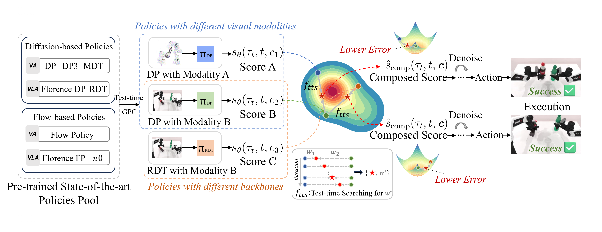
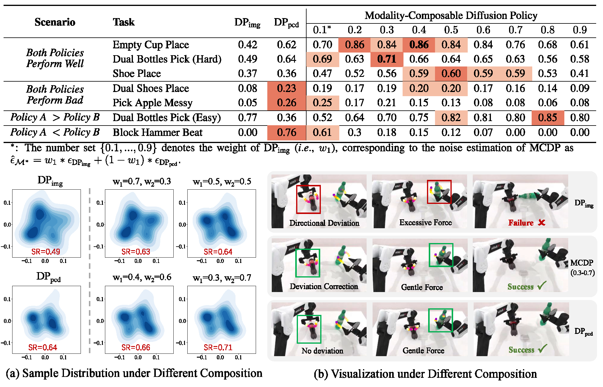

<h1 align="center">
	[ICLR 2026] General Policy Composition (GPC)<br>
</h1>

<p align="center">
  <a href='https://arxiv.org/pdf/2510.01068'>
    
  </a>
  <a href='https://sagecao1125.github.io/GPC-Site/static/files/GPC_paper.pdf' style='padding-left: 0.5rem;'>
    
  </a>
  <a href='https://sagecao1125.github.io/GPC-Site/' style='padding-left: 0.5rem;'>
    
  </a>
</p>

<div align="center">
  <br>
  
  <br>
</div>

We propose General Policy Composition (GPC), a training-free method that enhances performance by combining the distributional scores of multiple pre-trained policies via a convex combination and test-time search. GPC is versatile, allowing for the plug-and-play composition of heterogeneous policies, including VA and VLA models, as well as those based on diffusion or flow-matching, irrespective of their input visual modalities.

## News

* **Jan 2026:** GPC is accepted to **ICLR 2026**.

## Repository Layout

This repository contains two implementations of GPC, organized by the RoboTwin version they are based on:

```
.
|-- robotwin1/   # GPC based on RoboTwin-1.0
|-- robotwin2/   # GPC based on RoboTwin-2.0
|-- README.md    # Unified entry point
|-- LICENSE
|-- pipeline.png
`-- exp.png
```

Use `robotwin1/` if you want to reproduce the original released code and experiments based on RoboTwin-1.0. Use `robotwin2/` if you want the updated RoboTwin-2.0 codebase with DP, DP3, RDT, and additional GPC composition settings.

Each version folder keeps its own original README and scripts. Unless otherwise noted, run the commands below from inside the corresponding version folder.

## Installation and Data Preparation

### RoboTwin-1.0 Version

The `robotwin1/` implementation is based on [RoboTwin-1.0](https://github.com/RoboTwin-Platform/RoboTwin/tree/RoboTwin-1.0). Please follow the RoboTwin-1.0 guidelines and the version-specific documentation in:

* `robotwin1/README.md`
* `robotwin1/INSTALLATION.md`
* `robotwin1/CONFIG_TUTORIAL.md`

### RoboTwin-2.0 Version

The `robotwin2/` implementation is based on [RoboTwin-2.0](https://github.com/robotwin-Platform/RoboTwin). Please follow the RoboTwin-2.0 usage guide for installation and environment setup:

* [RoboTwin-2.0 documentation](https://robotwin-platform.github.io/doc/usage/index.html)
* `robotwin2/README.md`

To collect demonstrations in the RoboTwin-2.0 version, run:

```
cd robotwin2
bash collect_data.sh ${task_name} ${task_config} ${gpu_id}
```

Here `task_config` is the RoboTwin task setting, for example `demo_clean`.

## Usage: RoboTwin-1.0 Version

### Step 1. Prepare Pre-trained Single-modality Diffusion Policies

Run a task and collect data:

```
cd robotwin1
bash run_task.sh ${task_name} ${gpu_id}
```

Process data for image-based Diffusion Policy training:

```
python script/pkl2zarr_dp.py ${task_name} ${head_camera_type} ${expert_data_num}
```

Train Diffusion Policy:

```
cd policy/Diffusion-Policy
bash train.sh ${task_name} ${head_camera_type} ${expert_data_num} ${seed} ${gpu_id}
```

Process data for 3D Diffusion Policy training:

```
cd ../../
python script/pkl2zarr_dp3.py ${task_name} ${head_camera_type} ${expert_data_num}
```

Train 3D Diffusion Policy:

```
cd policy/3D-Diffusion-Policy
bash train_ddpm.sh ${task_name} ${head_camera_type} ${expert_data_num} ${seed} ${gpu_id}
```

**Note**: The action distribution spaces of the composed policies should be aligned. In practice, keep the noise scheduler settings consistent across DP and DP3, including prediction type and inference time steps.

### Step 2. Compose Pre-trained Policies

Move to `robotwin1/policy/3D-Diffusion-Policy` and evaluate MCDP:

```
bash eval_composed.sh ${task_name} ${head_camera_type} ${expert_data_num} ${checkpoint_num} ${seed} ${gpu_id} ${dp_w} ${dp3_w}
```

Example:

```
bash eval_composed.sh dual_bottles_pick_hard L515 100 3000 0 0 0.3 0.7
```

## Usage: RoboTwin-2.0 Version

The `robotwin2/` version separates single policies and composed policies into dedicated folders:

* `policy/DP`: image-based Diffusion Policy.
* `policy/DP3`: point-cloud-based 3D Diffusion Policy.
* `policy/RDT`: Robotics Diffusion Transformer.
* `policy/MCDP`: GPC composition of DP + DP3.
* `policy/MCDP_RDT`: GPC composition of DP + RDT.
* `policy/MCDP3_RDT`: GPC composition of DP3 + RDT.
* `policy/MCDP_DP3_RDT`: optional three-policy GPC composition of DP + DP3 + RDT.

The usual workflow is:

1. Collect demonstrations with RoboTwin.
2. Train or prepare the single-policy checkpoints.
3. Edit the composed policy YAML file to point to the checkpoints.
4. Run the composed-policy evaluation script from the corresponding composed-policy folder.

### Step 1. Collect Demonstrations

```
cd robotwin2
bash collect_data.sh ${task_name} ${task_config} ${gpu_id}
```

### Step 2. Prepare Single Policies

Train and evaluate DP:

```
cd policy/DP
bash train.sh ${task_name} ${task_config} ${expert_data_num} ${seed} ${action_dim} ${gpu_id}
bash eval.sh ${task_name} ${task_config} ${ckpt_setting} ${expert_data_num} ${seed} ${gpu_id}
```

Train and evaluate DP3:

```
cd ../DP3
bash train.sh ${task_name} ${task_config} ${expert_data_num} ${seed} ${gpu_id}
bash eval.sh ${task_name} ${task_config} ${ckpt_setting} ${expert_data_num} ${seed} ${gpu_id}
```

To train DP3 with RGB point-cloud color:

```
bash train_rgb.sh ${task_name} ${task_config} ${expert_data_num} ${seed} ${gpu_id}
```

Prepare, train, and evaluate RDT:

```
cd ../RDT
bash process_data_rdt.sh ${task_name} ${task_config} ${expert_data_num} ${gpu_id}
bash generate.sh ${config_name}
bash finetune.sh ${config_name}
bash eval.sh ${task_name} ${task_config} ${model_name} ${checkpoint_id} ${seed} ${gpu_id}
```

### Step 3. Configure GPC Checkpoints

Before running GPC evaluation, edit the corresponding YAML file:

* DP + DP3: `robotwin2/policy/MCDP/deploy_policy.yml`.
* DP + RDT: `robotwin2/policy/MCDP_RDT/deploy_policy.yml`.
* DP3 + RDT: `robotwin2/policy/MCDP3_RDT/deploy_policy.yml`.
* DP + DP3 + RDT: `robotwin2/policy/MCDP_DP3_RDT/deploy_policy.yml`.

The YAML files specify checkpoint settings such as:

```
dp_ckpt_setting: demo_clean
dp_expert_data_num: 50
dp_checkpoint_num: 600
dp_seed: 0

dp3_ckpt_setting: demo_clean
dp3_expert_data_num: 50
dp3_checkpoint_num: 3000
dp3_seed: 0
dp3_use_rgb: false

rdt_checkpoint_num: 5000
rdt_step: 32
```

For distribution-level composition, the composed policies should share an aligned action distribution space. In practice, keep the action dimension, action horizon, scheduler family, prediction type, and inference steps consistent across the policies being composed.

### Step 4. Compose Policies with GPC

Run the composed evaluation scripts from inside each composed-policy folder. The scripts will `cd` back to the RoboTwin-2.0 version root internally.

DP + DP3:

```
cd robotwin2/policy/MCDP
bash eval_composed.sh ${task_name} ${task_config} ${ckpt_setting} ${gpu_id} ${dp_w} ${dp3_w}
bash eval_composed_multi.sh ${task_name} ${task_config} ${ckpt_setting} ${gpu_id}
```

DP + RDT:

```
cd robotwin2/policy/MCDP_RDT
bash eval_composed_multi.sh ${task_name} ${task_config} ${ckpt_setting} ${gpu_id}
```

DP3 + RDT:

```
cd robotwin2/policy/MCDP3_RDT
bash eval_composed_multi.sh ${task_name} ${task_config} ${ckpt_setting} ${gpu_id}
```

DP + DP3 + RDT:

```
cd robotwin2/policy/MCDP_DP3_RDT
bash eval_composed_multi.sh ${task_name} ${task_config} ${ckpt_setting} ${gpu_id}
```

Evaluation results are saved under:

```
robotwin2/eval_result/${task_name}/${composed_policy_name}/${task_config}/
```

Sweep logs are saved under `robotwin2/logs/`.

## Experiment

For the RoboTwin-1.0 experiments, each task was evaluated under the L515 camera setting. `DP_img` and `DP_pcd` correspond to the image-based Diffusion Policy and point-cloud-based 3D Diffusion Policy, respectively.



## Findings

1. When both DPs have moderate accuracy, MCDP often achieves higher accuracy under appropriate weight configurations compared to unimodal DPs.
2. When one DP has significantly lower accuracy, MCDP struggles to surpass the highest accuracy of the better-performing unimodal DP.
3. The improvement of MCDP is maximized when the better-performing unimodal DP holds a larger weight in MCDP.

## Acknowledgement

Our code is generally built upon [RoboTwin](https://github.com/robotwin-Platform/RoboTwin), [3D Diffusion Policy](https://github.com/YanjieZe/3D-Diffusion-Policy), [Diffusion Policy](https://github.com/real-stanford/diffusion_policy), and [RDT](https://github.com/thu-ml/RoboticsDiffusionTransformer). We thank all these authors for their open-source contributions to the community.

## Citation

```
@article{cao2025gpc,
      title={Compose Your Policies! Improving Diffusion-based or Flow-based Robot Policies via Test-time Distribution-level Composition}, 
      author={Jiahang Cao and Yize Huang and Hanzhong Guo and Rui Zhang and Mu Nan and Weijian Mai and Jiaxu Wang and Hao Cheng and Jingkai Sun and Gang Han and Wen Zhao and Qiang Zhang and Yijie Guo and Qihao Zheng and Chunfeng Song and Xiao Li and Ping Luo and Andrew F. Luo},
      journal={arXiv preprint arXiv:2510.01068},
      year={2025},
      url={https://arxiv.org/abs/2510.01068}, 
}
```

## License

This repository is released under the MIT license. See [LICENSE](./LICENSE) for additional details.
